# Eagle-1-64Bit

[](https://paulp143.github.io/Eagle-1-64Bit/)
[](https://github.com/paulp143/Eagle-1-64Bit/releases/latest/download/Eagle-1-Windows.zip)
[](https://github.com/paulp143/Eagle-1-64Bit/releases/latest/download/Eagle-1-macOS.dmg)
[](https://github.com/paulp143/Eagle-1-64Bit/releases/latest/download/Eagle-1-Linux.tar.gz)
[](https://github.com/paulp143/Eagle-1-64Bit/actions/workflows/ci.yml)
[](https://github.com/paulp143/Eagle-1-64Bit/releases/latest)

A 2D top-down space combat arcade game built in Python using Pygame. The game features an expansive 3000×3000 scrolling arena, inertia-driven flight mechanics, quad-cannon combat, homing rockets, radar lock-on modes, a power-up system, friendly Helldiver ground squads, hostile Automaton ground forces, destructible fabricators, a stratagem air strike arsenal, a dynamic predictive aiming reticle, a multi-act narrative campaign with in-flight radio dilemmas and slow-motion choices, a Super Destroyer capital ship hub deck, a fully interactive 6-tab in-game help menu, and a keyboard-navigable "Military Terminal" interface across every screen.

> 🌐 **Official Website & Downloads:** [paulp143.github.io/Eagle-1-64Bit](https://paulp143.github.io/Eagle-1-64Bit/)

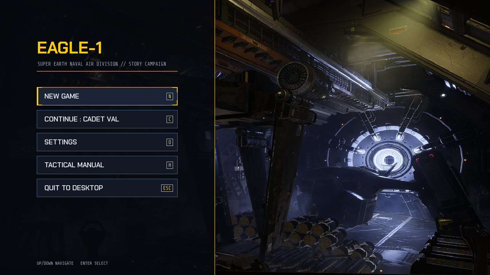


## Table of Contents

- [Overview](#overview)
- [Key Features](#key-features)
- [Story Campaign Subsystem (Acts I & II)](#story-campaign-subsystem-acts-i--ii)
  - [Campaign Structure & Canonical Sorties 1–4](#campaign-structure--canonical-sorties-14)
  - [In-Flight Narrative Dilemmas & Slow-Motion](#in-flight-narrative-dilemmas--slow-motion)
  - [The 500kg Friendly-Fire Crisis (Sortie 3)](#the-500kg-friendly-fire-crisis-sortie-3)
  - [Factory Strider Boss Raid & Dynamic Banter (Sortie 4)](#factory-strider-boss-raid--dynamic-banter-sortie-4)
  - [Super Destroyer Catapult Launch & Debriefing Loop](#super-destroyer-catapult-launch--debriefing-loop)
- [Ground Support & Helldivers Subsystem](#ground-support--helldivers-subsystem)
  - [Allied Helldiver Squad (Viper 1-4)](#allied-helldiver-squad-viper-1-4)
  - [Hostile Ground Forces & Fabricators](#hostile-ground-forces--fabricators)
  - [Air-to-Ground Combat (Cannons, Rockets & Strikes)](#air-to-ground-combat-cannons-rockets--strikes)
  - [Helldiver Tactical CAS Call-In Missions](#helldiver-tactical-cas-call-in-missions)
  - [Tactical Supply Drops (`X`)](#tactical-supply-drops-x)
  - [Objectives & Pelican-1 Extraction](#objectives--pelican-1-extraction)
  - [Scoring & CAS Multipliers](#scoring--cas-multipliers)
- [Predictive Aiming Reticle System](#predictive-aiming-reticle-system)
- [Air Strike Weapon Arsenal](#air-strike-weapon-arsenal)
- [Power-Up System](#power-up-system)
- [Homing Rockets & Radar System](#homing-rockets--radar-system)
- [Help Menu (6 Tabs)](#help-menu-6-tabs)
- [Gameplay Description](#gameplay-description)
- [Controls](#controls)
- [Game Audio & Extensible Settings Architecture](#game-audio--extensible-settings-architecture)
- [Automated Testing Suite](#automated-testing-suite)
- [Requirements & Dependencies](#requirements--dependencies)
- [Installation Instructions](#installation-instructions)
- [Development Setup](#development-setup)
- [Run Instructions](#run-instructions)
- [Usage Examples](#usage-examples)
- [Project Architecture Overview](#project-architecture-overview)
- [Folder Structure Overview](#folder-structure-overview)
- [Asset Organization](#asset-organization)
- [Configuration Explanation](#configuration-explanation)
- [Troubleshooting](#troubleshooting)
- [Community & Governance](#community--governance)
- [License & Credits](#license--credits)


## Overview

**Eagle-1-64Bit** is an arcade space dogfighting game where players pilot a combat spacecraft across an expansive 3000×3000 pixel starfield. The game is engineered around a 60 FPS update loop and includes dynamic enemy spawns, surface battlefields with allied Helldivers and hostile Automaton forces, destructible foundries, air strikes, power-ups, radar targeting, and persistent highscore tracking.

A custom 2D camera tracks the player ship across the map, clamping to world borders and rendering seamless starfield background tiles. Combat combines primary quad-cannon salvos with secondary steerable homing rockets, 8 stratagem air strikes, and close air support missions for friendly ground troops fighting against hostile Automaton forces.


## Key Features

- **Story Campaign Mode & Pilot Enlistment:** Streamlined story-driven main menu (`NEW GAME`, conditional `CONTINUE` locked until enlistment, `SETTINGS`, `TACTICAL MANUAL`, `QUIT TO DESKTOP`). Recruits enter their official pilot callsign, review the official Super Earth Helldivers Division **Contract of Employment** (with all indemnity, martyrdom deductions, and binding Clause 6.4), and take the Oath of Democracy before deploying.
- **Super Destroyer Hub Deck Screen (`game_state == "super_destroyer"`):** Staging tactical and narrative hub aboard the *SES Leviathan of Truth* overlooking Vandalon Prime. Freely explore 3 operational zones:
  - **The Bridge:** Confer with Democracy Officer Karl Reiner and Ship Master Cynthia Vance regarding high command directives and the Super Earth Patriotism Index.
  - **The Ready Room:** Debrief Fireteam Viper (Apex, Braker, Ghost, Doc) with dynamic dialogue reacting to recent sortie casualties, flawless squad extractions, and replacement reinforcements.
  - **The Hangar Deck:** Inspect real-time aircraft hull integrity with Chief Engineer Rylan Ortiz, review operational sortie briefing cards, and initiate hydraulic catapult launch into combat.
- **Interactive 3-Choice Dialogue System:** Dynamic typewriter narrative interface with high-res character portraits and stance options (Loyal, Neutral, Dissident) directly modulating player loyalty and squad survival.
- **Narrative Campaign Progression (Acts I & II, Milestone 4):** A 4-sortie story campaign linking low-altitude combat directly to character-driven radio decisions:
  - **Sortie 1 ("Baptism of Fire"):** Air superiority dogfight against drone swarms with Officer Reiner's command override (fleet priority targets vs. squad cover).
  - **Sortie 2 ("The Red Perimeter"):** Base defense holding action with mounting squad casualty radio traffic.
  - **Sortie 3 ("The Fabricator Furnace"):** Outpost demolition with the pivotal 500kg friendly-fire dilemma where Viper-2 Braker is trapped near the primary vent.
  - **Sortie 4 ("The Iron Colossus"):** Colossal Factory Strider boss raid, mid-fight armor crisis, and dynamic pre-extraction casualty check banter adapting to squad survival.
- **Combat Telemetry & Narrative Trigger Engine (`NarrativeTriggerManager`):** Real-time 60 FPS evaluation of battlefield milestones (`CombatTelemetrySnapshot`) ensuring chronological cue dispatch.
- **Tactical Time Dilation (0.4× Slow-Motion):** Radio dilemma transmissions automatically engage 0.4× slow-motion, providing critical reaction time while keeping thruster steering and quad-cannons fully responsive.
- **Super Earth Naval Academy Tutorial Mission (`academy_briefing.py`):** The introductory campaign training sortie guided by Chief Flight Drill Instructor Commander Vance. Features 6 progressive training drills (yaw steering gates, afterburners & air brakes, hazard perimeter turnaround, convergence pip cannon accuracy, radar modes & missile lock, and 500kg CAS bunker strike) culminating in a graduation ceremony awarding the "Wings of Liberty" aviator badge and unlocking operational stratagems.
- **Mission Selection System:** Tactical operational menu (`game_state = "mission_select"`, opened via `MISSIONS` on the After-Action Report) featuring 5 focused arcade modes alongside the story campaign.
- **5 Focused Operational Modes:**
  - **Air Superiority:** Pure aerial dogfighting against 5 wave squadrons (ground hostiles disabled); extraction beacon deploys upon wave 5 completion.
  - **Orbital Base Defense:** Protect a stationary friendly Orbital Defense Base across 5 waves against rebalanced **Automaton Bombers** (75 HP). Extraction is strictly gated until all 5 bomber waves are repelled and bombers are no longer spawning, whereupon Pelican-1 deploys for evacuation.
  - **Factory Strider Boss Raid:** Cooperate with Helldivers to destroy a colossal 300 HP **Factory Strider** walking fortress firing heavy plasma bolts with laser targeting telegraphs. Defeating the boss auto-triggers Pelican extraction.
  - **Outpost Demolition:** Demolish 3 Automaton Fabricator foundries defended by Troopers & Walkers across 6 waves, auto-triggering Pelican extraction upon clearing the foundries.
  - **Endless War:** Combined full-scale classic operation featuring all ground and aerial hostiles.
- **Cross-Platform Standalone Packaging:** Native standalone distribution via PyInstaller for Windows (`.zip`), macOS (`.dmg` disk image and `.zip`), and Linux (`.tar.gz`) without requiring a local Python installation.
- **Military Terminal UI:** One design system (`src/eagle1/ui/theme.py`) for every screen: dark navy panels with sharp corners and yellow corner brackets, bundled OFL fonts (Chakra Petch, Share Tech Mono), arrow-key + `Enter` navigation in all menus, non-overlapping HUD zones, and a single key-binding list shared by the Settings menu, the Tactical Manual and the HUD hint bar.
- **Automated Headless Test Suite:** 978 automated pytest tests covering mission configs, ground combat, fabricators, stratagems, flight physics, player profiles, enlistment, academy drills, Super Destroyer hub deck, NPC dialogue trees, in-flight narrative triggers, campaign sessions, UI theme/layout guards (no per-frame allocations, no unsupported glyphs, no overlapping HUD zones), and full regression suites.


## Story Campaign Subsystem (Acts I & II)

The narrative campaign bridges high-speed flight mechanics and character-driven drama. Flight Lieutenant Val flies Close Air Support for Fireteam Viper under the watchful eye of Democracy Officer Karl Reiner, confronting the harsh moral arithmetic of Super Earth high command.

Every campaign starts with enlistment: the recruit types a callsign, reviews the Contract of Employment and signs before the Naval Academy drills.

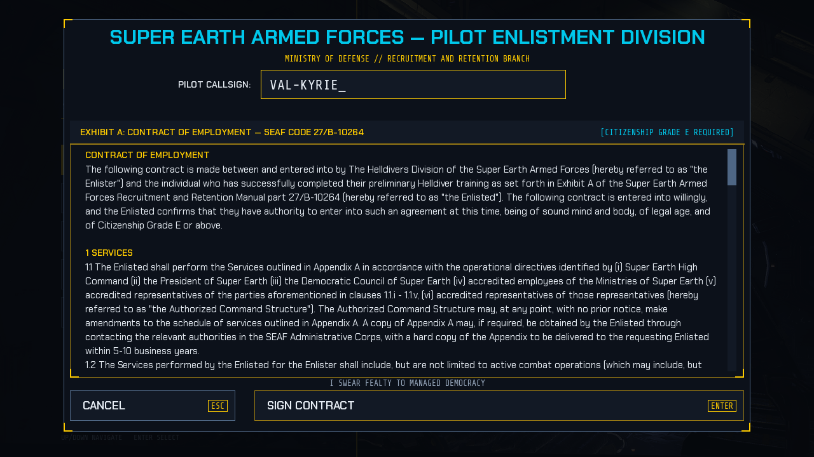
*Pilot enlistment (`NEW GAME`): callsign input, contract and oath; validation errors stay on screen.*


### Campaign Structure & Canonical Sorties 1–4

The campaign is orchestrated by `MissionController` and registered in `CAMPAIGN_SORTIE_REGISTRY`:

1. **Sortie 1: Baptism of Fire (`MissionType.AIR_SUPERIORITY`)**:
   - Initial dogfight over Vandalon Prime.
   - **In-Flight Dilemma (`sortie_1_inflight`)**: Reiner orders immediate engagement of primary fighter wings, abandoning squad low-altitude cover. Choosing **[1] LOYAL** commits all passes to fighters (+8.0 loyalty), while **[3] DISSIDENT** breaks formation to cover Viper Squad (-8.0 loyalty).
2. **Sortie 2: The Red Perimeter (`MissionType.BASE_DEFENSE`)**:
   - Holding action defending the orbital defense base.
   - Radio chatter reports mounting squad casualties and desperate perimeter defense.
3. **Sortie 3: The Fabricator Furnace (`MissionType.OUTPOST_DEMOLITION`)**:
   - High-threat assault on fortified Automaton fabricator complexes.
   - Low-altitude approach vector marked by Viper-3 Ghost.
   - **The 500kg Friendly-Fire Crisis (`sortie_3_500kg_crisis`)**: See below.
4. **Sortie 4: The Iron Colossus (`MissionType.STRIDER_RAID`)**:
   - Direct assault on the Factory Strider command fortress.
   - Mid-fight weakpoint crisis when boss HP falls below 50% or Helldivers are critically wounded.
   - **Casualty Check Beat**: Pre-extraction radio lines acknowledging squad survivors and remembering fallen members.

### In-Flight Narrative Dilemmas & Slow-Motion

- **0.4× Decision Slow-Motion:** When an in-flight radio dilemma is triggered, `CampaignSortieSession` applies `DECISION_TIME_DILATION = 0.4` to entity velocities and weapon cooldowns. Flight steering, throttle, and quad-cannons remain fully responsive.
- **Priority-Driven Firing:** Triggers carry strict descending priorities ($100 \to 80 \to 60$). If multiple events fire simultaneously (e.g. the Factory Strider spawning below 50% HP), the arrival callout is guaranteed to play before the crisis transmission.

### The 500kg Friendly-Fire Crisis (Sortie 3)

Triggered upon destroying the first fabricator or when wave 2 begins, Viper-4 Doc screams over the radio that Viper-2 Braker is trapped under a collapsed girder next to the primary furnace vent. Officer Reiner issues a direct order to release the bomb immediately:

- **[1. LOYAL] Releasing ordnance! Acceptable collateral damage (`+12.0` Loyalty)**:
  - Destroys the fabricator instantly.
  - Inflicts fatal collateral damage on Viper-2 Braker (`apply_scripted_casualty(1)`).
  - Net Loyalty shift is **`+8.5`** (`+12.0` obedience bonus minus `3.5` squad casualty penalty).
- **[2. NEUTRAL] Adjusting impact vector by 15 meters east (`0.0` Loyalty)**:
  - Breaches the perimeter, inflicting 50% max HP damage to the fabricator.
  - Leaves Braker alive but heavily wounded (shields cleared, HP reduced to 25%).
- **[3. DISSIDENT] Aborting drop! Coming in with cannons! (`-12.0` Loyalty)**:
  - Aborts the 500kg drop; the fabricator remains intact.
  - Braker survives uninjured; HUD objective updates to destroy the vent manually with guns.

### Factory Strider Boss Raid & Dynamic Banter (Sortie 4)

Before Pelican-1 extraction in Sortie 4, `emit_sortie4_casualty_check` queries both the current squad casualty count and whether Braker survived Sortie 3:
- **Flawless (0 KIA, Braker alive)**: Braker boasts about buying the first round at the mess.
- **Flawless Memorial (0 KIA in Sortie 4, Braker fallen in Sortie 3)**: Doc remarks that Braker would have hated how quiet the extraction is.
- **Partial Casualties (1–3 KIA)**: Pelican-1 reports wounded and fallen aboard.
- **Squad Wiped (4 KIA)**: Pelican-1 reports a silent LZ with no Viper beacons responding.

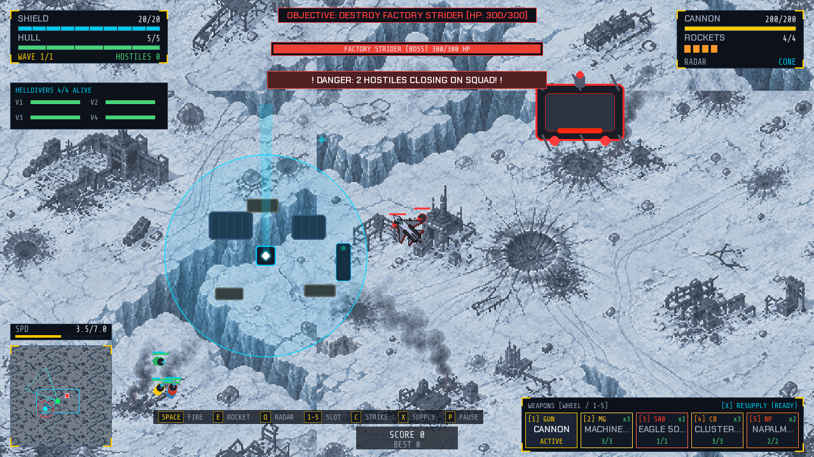
*The Factory Strider raid: boss health bar under the objective, squad danger banner and the walking fortress top right.*


### Super Destroyer Catapult Launch & Debriefing Loop

Between sorties, the pilot returns to the *SES Leviathan of Truth*:
- **The Bridge:** Review Patriotism Index (Loyalty: 0.0 to 100.0) with Officer Reiner.
- **The Ready Room:** Check on surviving squad members and morale.
- **The Hangar:** Review the sortie tactical briefing card and pull the catapult launch lever to deploy into the next operation.
- **Debriefing Screen:** Mission victory triggers `MissionController.complete_current_sortie()`, calculating mission performance rank, squad survival bonuses, and advancing the campaign counter.

| Hub Deck: The Bridge | NPC Dialogue (`Tab` focus, `E` talk) |
| :---: | :---: |
| 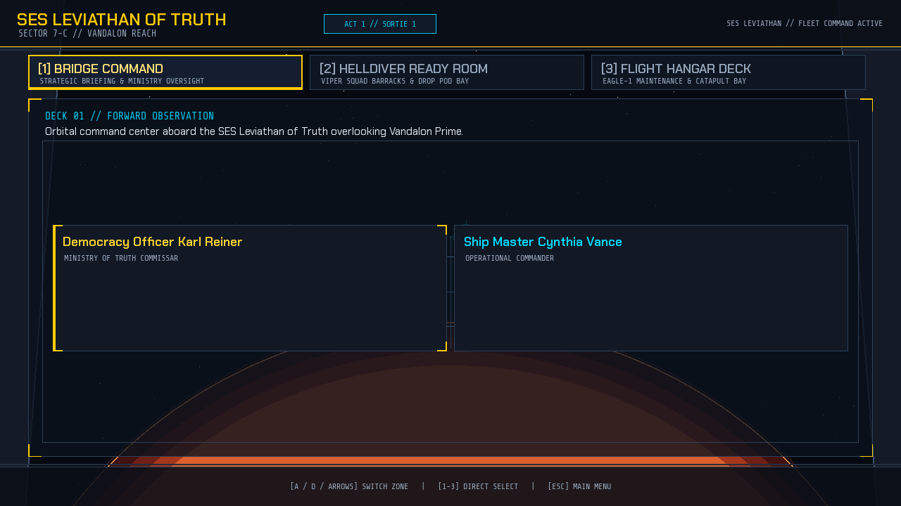 | 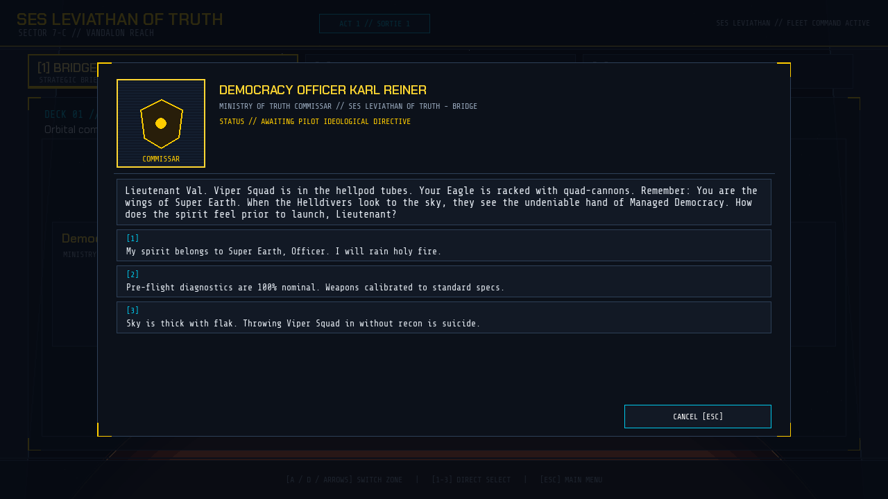 |

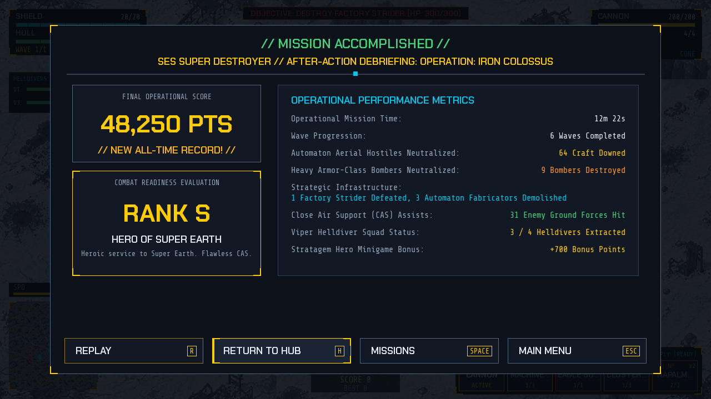
*After-Action Report: rank, combat statistics and the REPLAY / RETURN TO HUB / MISSIONS / MAIN MENU buttons (arrow keys + `Enter`).*


## Ground Support & Helldivers Subsystem

The ground support subsystem (`ground_support.py`) brings a living planetary battlefield to life. Players command Close Air Support (CAS) from Eagle-1 to protect, resupply, and evacuate an allied 4-trooper ground squad on the surface while battling hostile Automaton ground forces.

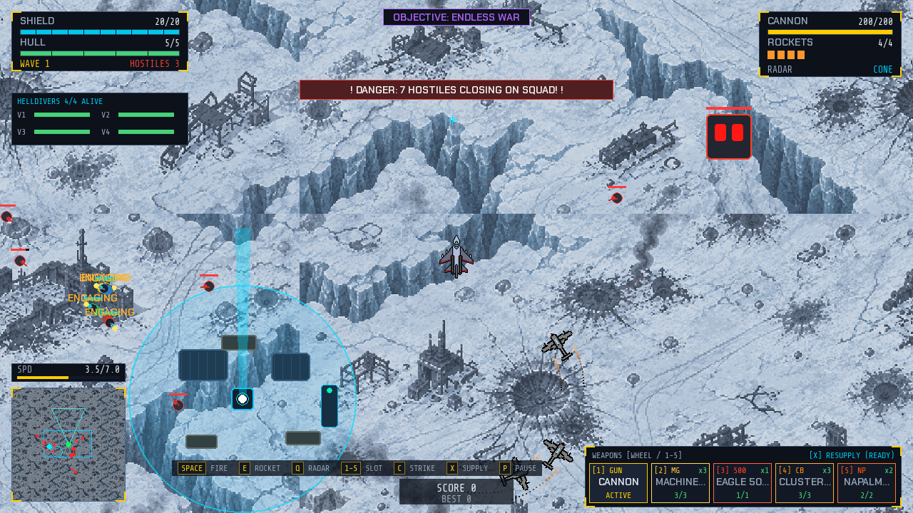
*Close Air Support over the Automaton front: status and squad panels (top left), weapons panel (top right), squad danger banner, minimap and speed gauge (bottom left), key hint bar and the stratagem dock (bottom right).*


### Allied Helldiver Squad (Viper 1-4)

- **Squad Roster:**
  - **Viper-1 (Lead):** Squad Leader with balanced tactical rifle.
  - **Viper-2 (Heavy):** Heavy Gunner deploying suppressing anti-air fire.
  - **Viper-3 (Scout):** Marksman delivering long-range precision rounds.
  - **Viper-4 (Medic):** Combat Medic providing tactical squad stabilization.
- **Autonomous Tactical AI:**
  - Navigates around terrain obstacles, bunkers, and sandbag barricades.
  - Automatically engages low-flying hostile aircraft with upward tracer rounds within 420px.
  - Engages enemy Automaton ground forces in fire-fights.
  - Intelligently paths towards landed Supply Pods when injured.
  - Moves to board the Pelican-1 dropship during extraction.
- **Health & Armor Tracking:** Overhead health/shield gauges and real-time state tags: `DEFENDING`, `ENGAGING`, `SUPPLYING`, `EXTRACTING`, and `K.I.A.`.
- **Minimap Representation:** Rendered as bright cyan blips surrounded by a defensive perimeter circle.

### Hostile Ground Forces & Fabricators

- **Automaton Troopers (`EnemyGroundUnit` - Trooper):**
  - Fast-moving foot soldiers (30 HP, 25 PTS) armed with red laser blasters.
  - Form battle lines and advance towards Helldiver defensive positions.
- **Automaton Heavy Walkers (`EnemyGroundUnit` - Walker):**
  - Armored bipedal walkers (100 HP, 60 PTS) equipped with rapid dual-pulse lasers.
  - Absorb sustained fire and pose high threat to Helldiver shields.
- **Automaton Fabricators (`EnemyFabricator`):**
  - Fortified manufacturing structures (220 HP, 150 PTS) with glowing thermal exhaust ports and factory antennas.
  - Continuously construct and deploy ground reinforcements (Troopers & Walkers): first unit after 12 seconds, then every 16 seconds.
  - Can be targeted and destroyed by cannons and precision air strikes, triggering multi-stage secondary explosions.

### Air-to-Ground Combat (Cannons, Rockets & Strikes)

- **Quad-Cannon Ground Strafing (`Spacebar`):**
  - Player bullets collide with and damage Automaton Troopers, Walkers, and Fabricator buildings.
  - Floating score popups (`+25 PTS`, `+60 PTS`, `+150 PTS`) indicate confirmed ground kills.
- **Homing Rockets are air-to-air only:**
  - Rockets ignore ground hostiles and fabricators; use cannons and stratagems against ground targets.
- **Stratagem Air Strikes (`C`):**
  - All 8 stratagem strikes damage both aerial hostiles and ground targets within their blast radius.

### Helldiver Tactical CAS Call-In Missions

- **Tactical CAS Requests (`SquadAirStrikeRequest`):**
  - When pressed by Automaton forces, the Helldivers deploy a tactical beacon beam and radio for Close Air Support.
  - Compatible with **all 8 stratagems** (e.g. Eagle 500kg Bomb, Napalm Strike, Cluster Bomb, Strafing Run, Gas Strike, Rocket Pods).
- **Automated Preparation:**
  - The requested stratagem is automatically prepared in the player's weapon menu with its cooldown bypassed for immediate deployment.
- **HUD Guidance:**
  - Displays a high-priority warning banner: `"TACTICAL CAS REQUESTED: DELIVER [WEAPON] TO TARGET ZONE"`.
  - An orbital beacon illuminates the coordinates, and the off-screen compass points directly toward the strike zone.
- **Delivery Reward:**
  - Releasing the requested ordnance over the target coordinates delivers the strike, granting a **`+500 PTS`** mission delivery bonus.

### Tactical Supply Drops (`X`)

- Deploy an orbital resupply pod via key **`X`** (30s cooldown).
- Lands with a deceleration thruster and deploys medical nanites and ammo crates.
- Restores shields and 60 HP to nearby Helldivers.
- Flying over the pod fully reloads the player's quad-cannon bullets and homing rockets, restores +10 shield and repairs +2 hull.

### Objectives & Pelican-1 Extraction

- **Phase 1: Outpost Defense (Waves 1-2):** Hold the line against hostile waves.
- **Phase 2: Pelican-1 Extraction (Wave 3+):** Extraction beacon activates with a 30-second countdown. Helldivers fall back and board the shuttle upon landing.
- **Objective Failure:** If all 4 Helldivers perish, the objective fails with score deductions.

### Scoring & CAS Multipliers

- **Close Air Support Bonus (+100 PTS):** Awarded when destroying hostiles near allied units.
- **CAS Mission Delivery Bonus (+500 PTS):** Awarded upon successfully delivering a requested strike to a Helldiver CAS beacon.
- **Fabricator Demolition (+150 PTS):** Awarded for destroying an Automaton factory.
- **Wave Survival Bonus (+500 PTS per Helldiver):** Awarded at wave clear per surviving squad member.
- **Flawless Protection Multiplier (1.5×):** Multiplies survivor bonuses by 1.5× if zero allied casualties were sustained.
- **Casualty Penalty (-250 PTS):** Deducted upon the loss of an allied Helldiver.
- **Pelican-1 Extraction (+2,500 PTS):** Awarded on successful evacuation of the ground squad.


## Predictive Aiming Reticle System

The dynamic aiming reticle (`AimingReticle` in `ground_support.py`) provides real-time fire-control projection:

1. **Gun Convergence Pip:**
   - Projects a subtle cyan crosshair pip at 180px in front of the aircraft along the current flight heading for gun strafing runs.
2. **Predictive Bomb / Strike Landing Zone:**
   - Calculates the exact projected ordnance landing coordinates ahead of the ship based on forward velocity and angle:
     $$\text{lead} = 320.0 + v \times 8.0$$
   - **Weapon-Specific Footprints:**
     - **Eagle 500kg Bomb:** Colossal circular blast perimeter with central target crosshairs.
     - **Strafing Run:** Directional rectangular corridor showing the 20mm cannon spray lane.
     - **Napalm Strike:** Wide perpendicular incendiary bar showing the firewall barrier.
     - **Cluster Bomb:** Multi-point submunition scatter pattern.
     - **Gas / EMS / Smoke:** Spherical dispersion ring matching effect radius.
3. **Target Lock Indicator:**
   - The reticle ring shifts to bright crimson with pulsing lock crosshairs whenever the predicted impact area is centered over enemy ground units, fabricators, or Helldiver CAS beacons.


## Air Strike Weapon Arsenal

Access the comprehensive stratagem arsenal by pressing **`V`** or **`TAB`** to open the interactive **Air Strike Weapon Menu**, select your 4-stratagem loadout prior to launch, or cycle between your Autocannon (Slot 1) and equipped stratagems (Slots 2–5) via number keys **`1`** through **`5`** or the single-slot mouse scroll wheel.

| Pre-Mission Loadout (`Enter` toggles, `Space` deploys) | In-Flight Arsenal (`V` / `TAB`) |
| :---: | :---: |
| 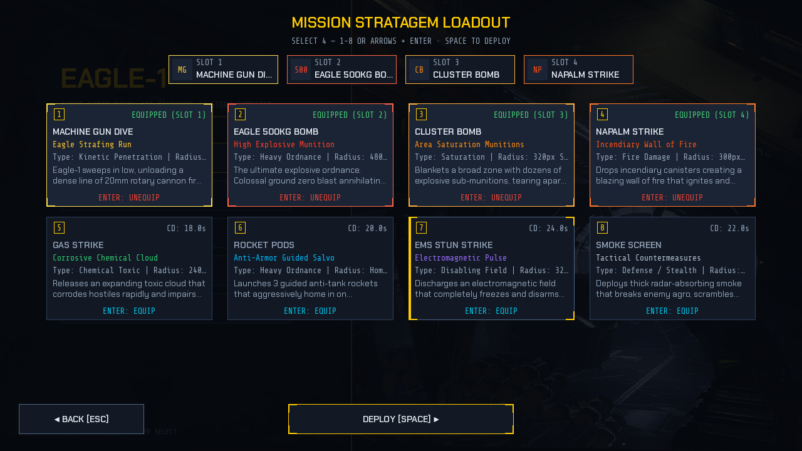 | 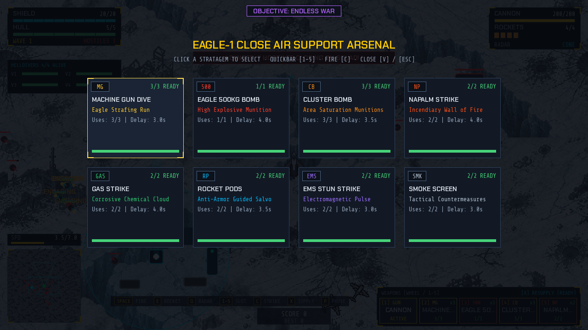 |


### Super Destroyer Orbital Rearm (`R`) & Stratagem Hero
Stratagems operate with discrete charge counts and fast operational delays between deployments. When charges are exhausted or low, pressing **`R`** triggers a **15.0s Super Destroyer Orbital Rearm**:
1. **Atmospheric Ascent (1.2s):** Eagle-1 accelerates skyward with flared afterburners and streaks through the upper atmosphere.
2. **Orbital Maintenance Bay & Combat Freeze (12.6s):** Eagle-1 docks in low orbit aboard the SES Super Destroyer maintenance deck. Ground combat is safely frozen so Helldivers cannot take damage while the player plays the **Stratagem Hero Arcade Terminal** (using Arrow Keys or WASD). The rearm is choreographed on the service pad:
   - An overhead gantry hoist slides over the airframe, extends its three-stage telescoping arm and lowers a 500 kg round onto Eagle-1, where the clamp jaws release it (latched at 3.5 s).
   - Two articulated service arms swing out of the pad to the wing pylons (4.5–7.5 s) with welding sparks.
   - A `REARM SEQUENCE` checklist (`ORDNANCE`, `WING PYLONS`, `CHARGES`, `FINAL CHECK`) and cyan airframe-scan brackets track progress until all systems report nominal.
3. **Catapult Launch & Atmospheric Re-entry (1.2s):** Eagle-1 catapults through the hangar blast doors with warning klaxons, plunging back to the battlefield with a fiery atmospheric plasma sheath, full weapon charges, and a 1.0s invulnerability window.

| Ordnance hoist (≈2.6 s) | Wing pylon service (≈5.8 s) |
| :---: | :---: |
| 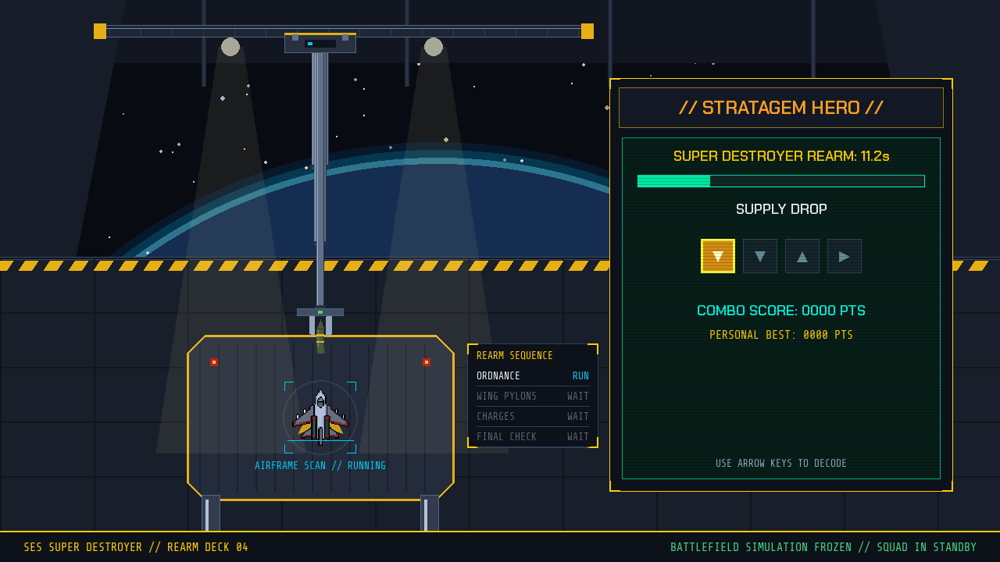 | 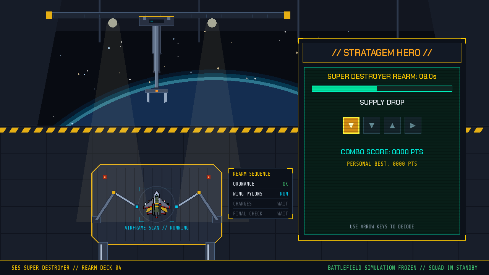 |

### Stratagem Arsenal Table

| Arsenal Key | Stratagem | Charges | Op Delay | Blast Profile | Effect & Tactical Application |
| :---: | :--- | :---: | :---: | :---: | :--- |
| **`1`** | **Machine Gun Dive** | 3 | 3.0s | Straight-line stream | 26 rapid 20mm rotary cannon tracer rounds (55px width) shredding targets along flight vector. |
| **`2`** | **Eagle 500kg Bomb** | 1 | 4.0s | 480px Colossal blast | Buffed high-explosive ground-zero detonation dealing massive 38.0 Heavy burst damage. |
| **`3`** | **Cluster Bomb** | 3 | 3.5s | 320px Carpet saturation | 10 explosive sub-munitions (5.2 damage each) blanketing a wide circular area against swarms. |
| **`4`** | **Napalm Strike** | 2 | 4.0s | 300px Wall of fire | Line of searing incendiary canisters igniting ground/air enemies with heavy burning damage over 6.5s. |
| **`5`** | **Gas Strike** | 2 | 4.0s | 240px Corrosive cloud | Lingering chemical cloud inflicting rapid corrosive tick damage and slowing enemies for 7.0s. |
| **`6`** | **Rocket Pods** | 2 | 3.5s | 3 Guided missiles | Heavy armor-piercing guided anti-tank missiles tracking priority hostile craft. |
| **`7`** | **EMS Stun Strike** | 2 | 3.0s | 320px EMP wave | Electromagnetic pulse disabling and freezing enemy flight systems and engines for 4.5s. |
| **`8`** | **Smoke Screen** | 2 | 3.0s | 300px Radar cloud | Thick radar-absorbing smoke screen breaking enemy agro and concealing ground forces. |


## Power-Up System

The game incorporates a dedicated power-up subsystem (`src/eagle1/systems/powerups.py`) providing 8 unique abilities divided into three rarity tiers.

### Abilities Table

| Ability | Symbol | Category | Rarity | Duration | Effect |
| :--- | :---: | :--- | :--- | :---: | :--- |
| **Rapid Fire** | `RF` | Offensive | **Common** | 10.0s | Cannon fire delay halved; reload delay reduced. |
| **Shield Bubble** | `SB` | Defensive | **Common** | 10.0s | Grants temporary shield overcharge and boosts shield regeneration. |
| **Thruster Overdrive** | `TO` | Utility | **Common** | 10.0s | Boosts max speed, acceleration, and turning rate. |
| **Chrono Slip** | `CS` | Utility | **Rare** | 8.0s | Slows enemy flight and projectile speed. |
| **Cryo Frostbite** | `CF` | Offensive / Utility | **Rare** | 10.0s | Slows enemies and can freeze them after repeated hits. |
| **Damage Multiplier** | `DM` | Offensive | **Rare** | 10.0s | Doubles primary cannon damage. |
| **Vanguard Drone** | `VD` | Defensive / Offensive | **Epic** | 20.0s | Deploys an escort drone that intercepts bullets and attacks enemies. |
| **Swarm Homing Pods** | `HP` | Offensive | **Epic** | 12.0s | Automatically launches self-guided micro-missiles at enemy craft. |

### Drop & Spawn Mechanics

- **Enemy Kill Drops:** Defeating an enemy has a base drop chance of **8%**.
- **Pity Counter:** Every kill without a drop adds **+3%** to the drop chance.
- **Rarity Weights:** Common drops occur 70% of the time, Rare drops 20%, and Epic drops 10%.
- **Drop Entity Lifecycle:** Drops float with bobbing animations, a pulsing glow ring, and rarity color indicators.
- **Magnetic Draw:** When the player flies within range, the drop is attracted toward the ship.
- **Score Milestones:** Major score milestones summon guaranteed supply airdrops.


## Homing Rockets & Radar System

### Secondary Homing Rockets (`Player.Rocket`)

- **Capacity & Reload:** Carries up to 4 rockets and reloads automatically (12.0 s) when depleted.
- **Target Acquisition:** Air-to-air only: acquires fighters, bombers and academy training drones.
- **Fire Controls:** Triggered using **Right Mouse Button**, `E`, `F`, or `Left Control`.
- **Flight Dynamics:** Rockets travel with smooth turning physics and explode on impact.
- **Enemy Countermeasures:**
  - *Beam break:* fighters that spot a rocket homing on them turn perpendicular to it at corner speed; a well-timed break can make the rocket overshoot (`EVADED`).
  - *Flares:* when a rocket closes in, fighters (1 salvo) and bombers (2 salvos) may eject flares that can pull it off target (`FLARES` / `MISSILE DECOYED`).
  - EMS-stunned, smoke-blinded and frozen (Freeze power-up) targets can neither break nor flare. Roughly two out of three rockets still hit a defending fighter.

### Dual Radar Modes (Toggle with `Q`)

- **`CONE` Mode (Long-Range Intercept):** Forward search arc (300px to 1050px) for head-on approaches.
- **`OMNI` Mode (Close-Quarter Dogfighting):** Wide forward arc (±75°, 0px to 420px); targets behind the ship cannot be locked.
- **Target Lock Indicator:** Lock brackets mark every radar-locked aerial target (fighters, bombers, drones); the minimap shows the active radar sector.


## Help Menu (6 Tabs)

Access the interactive in-game tactical manual at any time by pressing **`H`**. Navigate tabs using number keys **`1`** through **`6`**, **`Tab`** / arrow keys (**`Shift+Tab`** goes back), or by clicking the tab headers:

| Tab | Title | Description |
| :---: | :--- | :--- |
| **1** | **Weapons** | Damage, velocities, ranges, cooldowns, and magazine stats for quad-cannons and homing rockets. |
| **2** | **Abilities** | Complete catalog of 8 tactical power-ups across Common, Rare, and Epic tiers. |
| **3** | **Radar (Q)** | Visual guide explaining long-range `CONE` vs close-range `OMNI` target tracking. |
| **4** | **Controls** | Keybindings generated from the same list as the Settings menu, plus system notes (rearm, slow-mo aiming, fullscreen). |
| **5** | **Enemies** | Wave formations, agro awareness, alignment-gated enemy fire, and anti-retreat nanite drops. |
| **6** | **Squad** | Ground squad roles, Automaton hostiles, fabricators, CAS call-in missions, and Pelican-1 extraction. |

| Tab 1: Weapons | Tab 6: Squad |
| :---: | :---: |
| 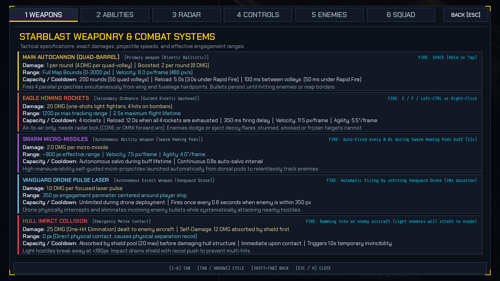 | 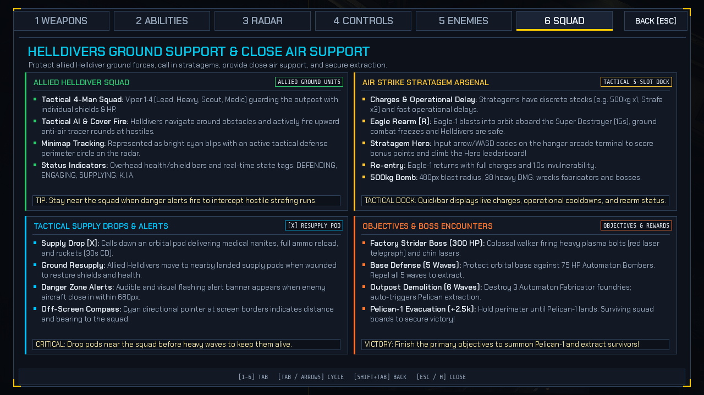 |


## Gameplay Description

### Objectives

1. **Survive:** Pilot your ship across the arena while staying within the boundary perimeter.
2. **Eliminate Aerial Threats:** Intercept descending `Light_Enemy` fighters with quad cannons and homing rockets.
3. **Protect Helldiver Squad:** Provide Close Air Support to the 4-trooper ground squad fighting Automaton ground forces.
4. **Demolish Fabricators:** Destroy Automaton foundries to halt enemy ground reinforcement waves.
5. **Execute CAS Missions:** Answer Helldiver strike requests by delivering the designated ordnance to target beacons.
6. **Evacuate the Squad:** Defend the extraction beacon in Wave 3+ until Pelican-1 safely extracts the squad.
7. **Surpass Highscores:** Beat your personal best, saved automatically to disk.

### Combat & Flight Mechanics

- **Continuous Velocity:** The ship is always in motion along its facing angle.
- **Quad Salvos:** Pressing Space fires 4 bullets simultaneously from 4 wing offsets.
- **Shield Absorption:** Incoming damage drains shield points first.
- **Reload Downtime:** Firing consumes ammunition and forces periodic reloads.
- **Ramming:** You can ram enemies to deal collision damage, but you will take damage too.

### Game States

`game_state` in `src/eagle1/app/game.py` drives every screen (`""` = active gameplay):

```text
[ Launch ] ──► main_menu ──N──► enlistment ──sign contract──► Academy tutorial ("")
                 │  │  │                                            │
                 │  │  └── O / H ──► settings_menu / help_menu ──ESC──► (back to caller)
                 │  └── ESC, ESC ──► quit                            └─ graduation ──► mission_debriefing
                 │
                 └── C / CONTINUE ─────────────────────────► super_destroyer (hub deck)
                                                                     │ L / F catapult launch
                                                                     ▼
          pause_menu ◄──P── gameplay ("") ──hull 0──► game over ──R──► respawn
           │ P / RESUME ──►    │                         └──SPACE──► main_menu
           └── ESC ──► main_menu │ victory
                                 ▼
                       mission_debriefing ──RETURN TO HUB──► super_destroyer
                                 │ MISSIONS
                                 ▼
                       mission_select ──Enter──► stratagem_select ──SPACE (4 equipped)──► gameplay ("")
```

| Operation Select (`mission_select`) | Pause Menu (`pause_menu`, frozen frame) |
| :---: | :---: |
| 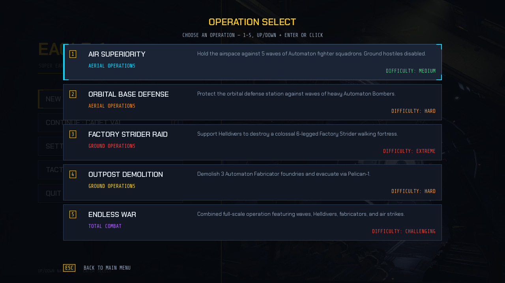 | 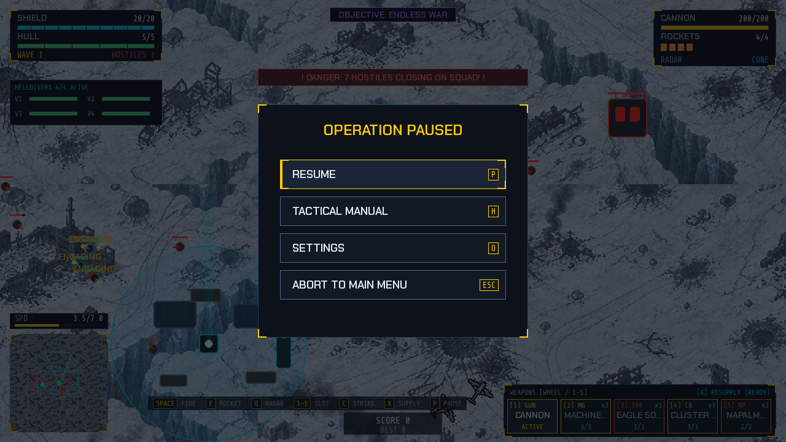 |


## Controls

| Action | Primary Key | Secondary Key | Applicable State |
| :--- | :--- | :--- | :--- |
| **Start New Game** | `N` | Click `NEW GAME` | Main Menu |
| **Continue Campaign** | `C` | Click `CONTINUE` | Main Menu (active service record) |
| **Steer Left (Counter-Clockwise)** | `A` | `Left Arrow` | Active Gameplay |
| **Steer Right (Clockwise)** | `D` | `Right Arrow` | Active Gameplay |
| **Accelerate / Increase Speed** | `W` | `Up Arrow` | Active Gameplay |
| **Decelerate / Decrease Speed** | `S` | `Down Arrow` | Active Gameplay |
| **Fire Quad Cannons** | `Spacebar` | Left Click | Active Gameplay |
| **Hold-to-Aim Stratagem (Slow-Mo)** | Hold `Spacebar` / Left Click | Release to deploy | Active Gameplay (Slots 2–5) |
| **Cycle Weapon Quickbar (Slots 1–5)** | `Scroll Wheel` | `1` - `5` | Active Gameplay |
| **Super Destroyer Rearm (15.0s)** | `R` | — | Active Gameplay |
| **Play Stratagem Hero Minigame** | `Arrow Keys` / `W,A,S,D` | `Up` / `Down` / `Left` / `Right` | Super Destroyer Hangar (during Rearm) |
| **Fire Secondary Homing Rocket** | `Right Mouse Button` | `E`, `F`, or `LCTRL` | Active Gameplay |
| **Launch Active Air Strike** | `C` | — | Active Gameplay |
| **Call Tactical Supply Drop** | `X` | — | Active Gameplay |
| **Toggle Air Strike Weapon Menu** | `V` | `TAB` | Active Gameplay |
| **Quick-Select Stratagems (1-8)** | `1` - `8` | — | Active Gameplay / Menu |
| **Toggle Radar Mode (`CONE` / `OMNI`)** | `Q` | — | Active Gameplay |
| **Open Help Menu** | `H` | — | Main Menu / Pause Menu / Game Over |
| **Help Menu Tabs (1-6)** | `1` - `6` | Click Tabs | Help Menu |
| **Open Settings & Audio Menu** | `O` | Click `SETTINGS` | Main Menu / Pause Menu / Game Over / Gameplay |
| **Settings Menu Tabs (1-3)** | `1` - `3` | Click Tabs | Settings Menu |
| **Instant Mute / Unmute Audio** | `M` | — | All States |
| **Navigate Menus** | `Up` / `Down` + `Enter` | Mouse hover + click | Main Menu / Pause Menu / Game Over / Mission Select |
| **Quit to Desktop** | `Escape` twice (first press focuses `QUIT TO DESKTOP`) | `Q` twice / Click `QUIT TO DESKTOP` | Main Menu |
| **Select Stratagem Loadout** | `1` - `8` or arrows + `Enter` | Click Card | Stratagem Loadout (pre-mission) |
| **Deploy Selected Loadout** | `Spacebar` (4 stratagems selected) | Click `DEPLOY` | Stratagem Loadout (pre-mission) |
| **Settings Navigation** | `Left` / `Right` / `Tab` (tabs), `Up` / `Down` (focus), `+` / `-` (slider), `Enter` (toggle) | Mouse | Settings Menu |
| **Focus NPC / Talk** | `Tab` cycles NPC cards, `E` talks to the focused NPC | Click NPC Card | Super Destroyer Hub Deck |
| **Choose Dialogue Option (keyboard)** | `Up` / `Down` then `Enter` | `1` / `2` / `3` | Super Destroyer NPC Dialogue |
| **Pause Game** | `P` | — | Active Gameplay |
| **Resume Game** | `P` | Click `RESUME` | Pause Menu |
| **Return to Main Menu** | `Escape` (`ESC`) | Click `ABORT TO MAIN MENU` | Pause Menu |
| **Close Help / Settings / Weapon Menu** | `Escape` (`ESC`) | Click `X` / close button | In Menus |
| **Respawn** | `R` | Click `RESPAWN` | Game Over (`Health <= 0`) |
| **Return to Main Menu** | `Spacebar` | Click `MAIN MENU` | Game Over (`Health <= 0`) |
| **Cycle Hub Deck Zones** | `A` / `D` | `Left` / `Right Arrow` | Super Destroyer Hub Deck |
| **Select Dialogue Stance Option** | `1` / `2` / `3` | Click Stance Card | Super Destroyer NPC Dialogue |
| **Close Dialogue / Exit to Menu** | `Escape` (`ESC`) | Click `CLOSE` | Super Destroyer Hub Deck |
| **Catapult Launch Sortie** | `L` / `F` | Click the catapult launch button | Super Destroyer Hangar Deck |
| **Return to Super Destroyer Hub** | `H` / `Enter` | Click `RETURN TO HUB` | Mission Debriefing Screen |

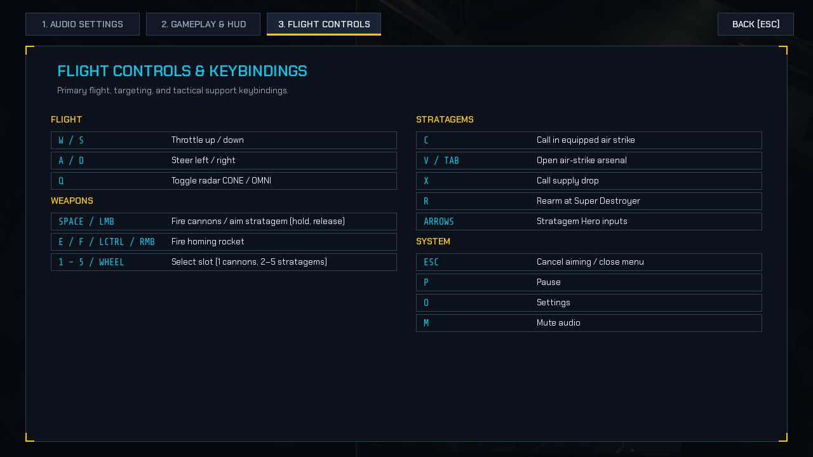
*The same bindings in-game (Settings → `3. Flight Controls`), generated from `src/eagle1/ui/controls_reference.py`.*

## Game Audio & Extensible Settings Architecture

Eagle-1-64Bit features a centralized, 16-channel audio system (`audio_manager.py`) with procedural audio generation (`generate_audio_assets.py`), dynamic combat music adaptation, thruster engine sound modulation, anti-clipping voice limiting, and an extensible tabbed Settings Menu (`settings_menu.py`).

### Key Audio Features
- **Centralized 16-Channel Mixer**: Dedicated low-latency voices for primary cannons, rockets, enemy gunfire, hits, explosions, alarms, pickups, UI feedback, and continuous engine loop.
- **Procedural High-Fidelity Synthesis**: 17 sound effects and 4 full music loops generated at 44.1kHz 16-bit stereo PCM with zero external download dependencies (supports dropping custom `.wav`/`.ogg` assets directly into `audio/`).
- **Dynamic Combat Music**: Automatically scales musical intensity between normal synthwave combat loops and high-threat themes based on active agro enemies, bombers, Factory Striders, or low health.
- **Flight Velocity-Modulated Engine Hum**: Continuous jet thruster frequency and volume scale smoothly with player acceleration and flight speed.
- **Anti-Clipping & Voice Limiting**: Configurable minimum intervals prevent audio stacking during intense bullet storms.
- **Extensible Settings Menu**: Modular, tabbed interface (`1. Audio Settings`, `2. Gameplay & HUD`, `3. Flight Controls`) with interactive volume sliders (Master, Music, SFX), Mute toggle switch, SFX test button, and persistence to `data/audio_settings.json`. Gameplay & HUD toggles (screen shake, speedometer, low hull/shield vignettes; the alarm audio always plays) persist to `data/gameplay_settings.json`. Easily extended with new categories and options.

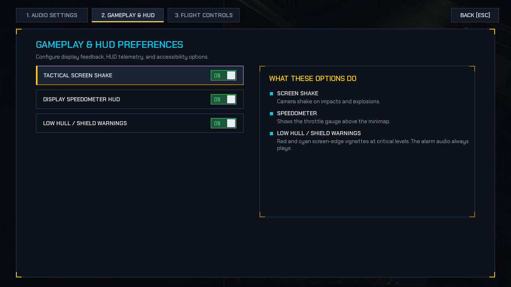
*Settings → `2. Gameplay & HUD`: toggles are keyboard-focusable (`Up` / `Down`, `Enter`) and saved across restarts.*


## Automated Testing Suite

The repository includes a comprehensive, headless automated test suite powered by `pytest` and configured via `pyproject.toml`. Headless dummy video and audio drivers (`SDL_VIDEODRIVER=dummy`, `SDL_AUDIODRIVER=dummy`) are initialized automatically in `tests/conftest.py`:

```bash
python -m pytest
```

Or run `pytest` directly with detailed test reporting:

```bash
pytest -v
```

### Test Coverage Summary (978 Tests, 66 Modules)

`tests/conftest.py` redirects `EAGLE1_USER_DATA_DIR` to a temporary directory for the whole session, so no test can read or overwrite the real `data/` files (profile, campaign save, settings, highscores).

| Area | Representative modules | What is covered |
| :--- | :--- | :--- |
| Flight & combat | `test_flight_dynamics.py`, `test_dogfight_combat.py`, `test_enemy_bfm_ai.py`, `test_missile_intercept.py`, `test_missile_defense.py`, `test_enemy_missile_evasion.py`, `test_rocket_air_only.py`, `test_radar_lock_zone.py`, `test_rocket_balance.py`, `test_health_and_damage.py`, `test_math_and_physics.py`, `test_weapons_and_cooldowns.py` | Inertia flight model, enemy BFM AI, rocket guidance, missile countermeasures (flares, beam evasion) and their seeded balance band, air-only rocket locks, radar lock zones, shields-first damage, camera clamping, reticle lead, cannon/rocket reloads, stratagem charges. |
| Ground war & missions | `test_ground_support.py`, `test_bomber_extraction.py`, `test_mission_modes_regression.py`, `test_mission_progression.py` | Helldiver squad AI, CAS delivery, supply drops, Factory Strider, extraction gating, all mission modes. |
| Story campaign | `test_act1_sorties.py`, `test_act2_sorties.py`, `test_campaign_e2e_progression.py`, `test_campaign_session.py`, `test_narrative_triggers.py`, `test_story_*.py`, `test_cinematic_player.py`, `test_super_destroyer.py` | Sortie triggers and dilemmas, loyalty vector, saves, cinematics, hub deck and NPC dialogue. |
| Tutorial & rearm | `test_academy_briefing.py`, `test_academy_integration.py`, `test_hangar_cinematic.py`, `test_hangar_cinematic_theme.py` | Academy drills and graduation, rearm phases, hoist/wing-arm choreography, Stratagem Hero highscore persistence. |
| UI system | `test_theme.py`, `test_widgets.py`, `test_menu_nav.py`, `test_controls_reference.py`, `test_hud_layout.py`, `test_hud_renderer.py`, `test_*_theme.py`, `test_main_menu_redesign.py`, `test_pause_gameover_ui.py`, `test_ui_consistency.py` | Design tokens and font fallback, keyboard navigation (ESC-twice quit, loadout SPACE/ENTER), HUD zones never overlap, no per-frame Surface/font allocation, no unsupported glyphs, settings persistence. |
| Platform & persistence | `test_paths.py`, `test_persistence.py`, `test_enlistment_and_profile.py`, `test_gameplay_settings.py`, `test_macos_compatibility.py`, `test_asset_casing.py` | User data dir resolution, atomic saves, corrupted-file recovery, macOS window flags, asset filename casing. |


## Requirements & Dependencies

- **Python:** Python 3.9+ (compatible with Python 3.10, 3.11, 3.12, 3.13, 3.14)
- **Core Dependencies:**
  - `pygame-ce>=2.5.0` (or `pygame>=2.5.0`)
- **Development & Testing Dependencies:**
  - `pytest>=8.0.0`
  - `ruff>=0.5.0`
  - `pyinstaller>=6.5.0`
- **Standard Library:** `os`, `sys`, `random`, `math`, `json`, `pathlib`


## Installation Instructions

1. Clone the repository:
   ```bash
   git clone https://github.com/paulp143/Eagle-1-64Bit.git
   cd Eagle-1-64Bit
   ```

2. Install runtime dependencies:
   ```bash
   pip install -r requirements.txt
   ```

   *Alternatively, install the package in editable mode:*
   ```bash
   pip install -e .
   ```


## Development Setup

To configure an isolated virtual environment for development and testing:

1. Create a virtual environment:
   ```bash
   python -m venv venv
   ```

2. Activate the virtual environment:
   - **Windows (PowerShell):** `venv\Scripts\Activate.ps1`
   - **Windows (CMD):** `venv\Scripts\activate.bat`
   - **Linux / macOS:** `source venv/bin/activate`

3. Install development dependencies:
   ```bash
   pip install -r requirements-dev.txt
   pip install -e .
   ```

4. Run the automated test suite:
   ```bash
   python -m pytest
   ```

5. Run code linting:
   ```bash
   ruff check .
   ```

6. Generate procedural audio waveforms (if needed):
   ```bash
   python tools/generate_audio_assets.py
   ```

---

## Run Instructions

Eagle-1-64Bit can be launched through multiple interfaces:

### Option 1: Installed Console Command
If installed via `pip install -e .`:
```bash
eagle1
```

### Option 2: Python Module Execution
```bash
python -m eagle1
```

### Option 3: Repository Root Launcher
```bash
python run_game.py
```

### Option 4: Compatibility Launcher
```bash
python main.py
```

### Option 5: macOS Standalone Application (`.dmg` / `.app`)
For players downloading standalone releases from GitHub Releases:
1. Download `Eagle-1-macOS.dmg` from the latest release.
2. Double-click the `.dmg` disk image and drag **`Eagle-1.app`** into your **`Applications`** folder.
3. **First-Time Launch (Gatekeeper Notice)**:
   Because this open-source build is distributed directly via GitHub outside the Mac App Store, macOS Gatekeeper may show a notice on first launch:
   - **Quick Method**: Right-click (or Control-click) `Eagle-1.app` in Finder -> select **Open** -> click **Open** in the confirmation dialog.
   - **Terminal Method**: Remove the quarantine flag:
     ```bash
     xattr -cr /Applications/Eagle-1.app
     ```
4. **macOS Features & Controls**:
   - **User Data Storage**: Persistent high scores and settings are safely stored in `~/Library/Application Support/Eagle-1/`.
   - **Clean Quit**: Press `Cmd + Q` from any menu or during flight to save progress and exit.
   - **Fullscreen**: Press `Cmd + F` or `F11` to toggle fullscreen with automatic aspect-ratio preserving letterboxing.
   - **Secondary Weapons**: Use two-finger trackpad tap or press `E` / `F` to launch homing rockets. Trackpad scroll dampening prevents erratic weapon cycling.


## Usage Examples

### Starting a Campaign

1. Run `python run_game.py` (or `python -m eagle1`).
2. Press `N` (or select `NEW GAME` with the arrow keys and `Enter`), type your callsign and sign the contract.
3. Fly the Naval Academy drills; afterwards `C` / `CONTINUE` takes you to the Super Destroyer hub.
4. In the hub, `A` / `D` switch zones, `Tab` focuses NPC cards, `E` talks to them, and `L` / `F` launches the next sortie from the hangar deck.

### Flying a Sortie

1. Steer with `A`/`D` and adjust throttle with `W`/`S`.
2. Fire quad cannons with `Spacebar`, and launch homing rockets with `Right Click` (or `E` / `F` / `LCTRL`) when locked on.
3. Pick a stratagem slot with `1`–`5` or the mouse wheel; hold `Spacebar` to aim in slow motion and release to deploy, or press `C` to call the equipped strike.
4. Answer Helldiver CAS requests by delivering the requested ordnance onto the beacon for `+500 PTS`.
5. Call a supply drop with `X`; press `R` for a full orbital rearm (15 s, plays Stratagem Hero).
6. Press `H` at any time for the Tactical Manual and `P` to pause.

### Arcade Operations

1. After a sortie, choose `MISSIONS` on the After-Action Report to open the operation list, then pick an operation with `Up` / `Down` + `Enter` (or `1`–`5`).
2. Choose four stratagems in the loadout (`1`–`8` or arrows to focus, `Enter` to toggle) and press `Spacebar` to deploy.


## Project Architecture Overview

```text
src/eagle1/
├── __main__.py               # CLI entrypoint for `eagle1` and `python -m eagle1`
├── paths.py                  # Centralized cross-platform asset, data, and root path resolver
├── effects.py                # Visual FX, particle bursts, floating damage & score text
├── app/
│   └── game.py               # 60 FPS main game loop, camera, player aircraft, aerial combat,
│                             # wave management, combat state machine, rendering pipeline, HUD
├── story/                    # Narrative Campaign Architecture (Acts I & II, Milestone 4)
│   ├── campaign_act1.py      # Sorties 1 & 2 trigger definitions, objective mappings & choice effects
│   ├── campaign_act2.py      # Sorties 3 & 4 trigger tables, 500kg friendly-fire crisis & casualty checks
│   ├── campaign_session.py   # Runtime session driver linking combat loop, time dilation & telemetry
│   ├── campaign_save.py      # Atomic JSON campaign persistence with tampering validation
│   ├── cinematic_player.py   # Letterboxed story cinematics (timeline, camera, subtitles, epilogue cards)
│   ├── comms_hud.py          # Time-dilated in-flight radio transmission and typewriter dialogue overlay
│   ├── dialogue_data.py      # Character dialogue scripts, dynamic radio banter queues & NPC profiles
│   ├── dialogue_db.py        # Centralized dialogue database (briefings, crises, debriefings)
│   ├── mission_controller.py # Canonical 4-sortie registry, sortie lifecycle & objective state
│   ├── narrative_trigger_manager.py # 60 FPS combat telemetry snapshot evaluator & priority dispatch
│   ├── story_manager.py      # Persistent narrative state machine, Patriotism Index (loyalty vector)
│   └── super_destroyer_view.py # 3-zone orbital hub deck screen (Bridge, Ready Room, Hangar Deck)
├── systems/
│   ├── ground_support.py     # Helldivers (Viper 1-4), Automaton ground units, fabricators,
│   │                         # Factory Strider boss, stratagems, CAS beacon requests,
│   │                         # supply drops, predictive reticle, weapon selection menu
│   ├── powerups.py           # 8 abilities across 3 rarities, drop mechanics with pity counter,
│   │                         # magnetics, escort drones, swarm homing micro-missiles
│   ├── audio_manager.py      # Centralized 16-channel mixer, procedural SFX & dynamic combat music,
│   │                         # thruster modulation, voice limiter, persistence
│   ├── academy_briefing.py   # Naval Academy tutorial scenario & 6 progressive flight drills
│   └── hangar_cinematic.py   # Orbital rearm cinematic (gantry hoist, wing service arms, checklist) + Stratagem Hero
├── ui/
│   ├── theme.py              # "Military Terminal" design tokens (palette, type scale) and bundled-font loader
│   ├── widgets.py            # Allocation-free panels, brackets, bars, TextCache, pixel-based text wrapping
│   ├── menu_nav.py           # MenuButton + MenuNavigator (keyboard and mouse focus)
│   ├── controls_reference.py # Single source of truth for key bindings shown in Settings, Help and the HUD
│   ├── hud.py                # HudRenderer: status cluster, weapons panel, minimap cache, banners, controls hint
│   ├── hud_layout.py         # Fixed, non-overlapping HUD zones (1280x720)
│   ├── layout.py             # Rect helpers (vertical stacks, overlap validation) used by menus and tests
│   ├── mission_select_menu.py # Operation selection list
│   ├── help_menu.py          # 6-tab tactical manual overlay (Weapons, Abilities, Radar, Controls, Enemies, Squad)
│   ├── settings_menu.py      # Tabbed settings interface (Audio, Gameplay/HUD, Flight Controls)
│   ├── gameplay_settings.py  # Persistence of the Gameplay/HUD toggles (gameplay_settings.json)
│   ├── enlistment_screen.py  # Pilot enlistment contract, callsign selection, and Oath of Democracy
│   └── debriefing_screen.py  # Post-mission After-Action Report (AAR) and performance ranking (S/A/B/C)
└── data/
    └── player_profile.py     # Pilot profile persistence, flight hours, and medal tracking

tools/
├── generate_audio_assets.py  # Standalone procedural audio waveform generator (44.1kHz stereo PCM)
├── generate_portrait_assets.py # Pixel-art character portrait synthesizer for comms and hub
├── build_macos_icon.py       # Apple `.icns` multi-resolution icon bundle generator
├── build_macos_dmg.py        # Drag-and-drop macOS `.dmg` installer packager
├── capture_screenshots.py    # Renders the README screenshots headlessly into images/screenshots/
└── package_macos.py          # Complete macOS standalone packaging pipeline (.app, .dmg, .zip)

tests/                        # Automated headless pytest suite (978 tests across 66 modules)
├── conftest.py               # Headless Pygame fixture, dummy surface, isolated user data dir
├── test_act1_sorties.py      # Sorties 1 & 2 dialogue, trigger evaluation, and objective shifts
├── test_act2_sorties.py      # Sorties 3 & 4 500kg crisis, casualty checks, and debriefing nodes
├── test_campaign_e2e_progression.py # Full campaign progression, catapult launches, and ending branches
├── test_campaign_session.py  # Game loop integration, slow-motion time dilation, and HUD synchronization
├── test_ground_support.py    # Helldivers, ground units, CAS delivery, and supply drops
├── test_health_and_damage.py # Health, shield absorption, and invulnerability mechanics
├── test_math_and_physics.py  # Flight physics, camera clamping, and predictive reticle lead
├── test_mission_progression.py # Mission controller, sortie registry, and debriefing transitions
├── test_narrative_triggers.py # Telemetry evaluation, trigger predicates, and dispatch queue capping
├── test_persistence.py       # High score file I/O and audio settings fallback
├── test_powerups.py          # Power-up drops, pity system, drone companions, and abilities
├── test_story_manager.py     # Narrative state mutations, loyalty vector calculation, and callbacks
├── test_super_destroyer.py   # 3-zone hub deck interactions, NPC dialogue, and launch state machine
├── test_ui_and_menus.py      # Help and settings menu navigation and rendering
└── test_weapons_and_cooldowns.py # Primary cannons, homing rockets, and stratagems
```

Root-level launcher scripts (`run_game.py`, `main.py`) and legacy wrappers (`ground_support.py`, `powerup_system.py`, `audio_manager.py`, `help_menu.py`, `settings_menu.py`, `academy_briefing.py`, `generate_audio_assets.py`) provide backward compatibility delegating directly to the modular package.


## Folder Structure Overview

```text
.
├── .github/
│   ├── workflows/
│   │   ├── build-exe.yml     # Standalone binary builder (Windows .zip, macOS .dmg/.zip, Linux .tar.gz)
│   │   ├── ci.yml            # Multi-OS test matrix (Ubuntu, macOS, Windows on Python 3.10–3.12)
│   │   └── deploy-pages.yml  # Automated GitHub Pages static website deployment
│   ├── ISSUE_TEMPLATE/
│   │   ├── bug_report.yml
│   │   └── feature_request.yml
│   └── PULL_REQUEST_TEMPLATE.md
├── assets/
│   └── fonts/                # Bundled OFL fonts (Chakra Petch, Share Tech Mono) + license texts
├── audio/
│   ├── music/
│   └── sfx/
├── data/
│   ├── audio_settings.json
│   ├── campaign_save.json
│   ├── gameplay_settings.json
│   ├── highscore.txt
│   ├── player_profile.json
│   └── stratagem_hero_highscore.txt
├── docs/                     # Local design notes, git-ignored (not part of the repository)
│   ├── intent.md             # High-level creative vision & player experience intent
│   ├── spec.md               # Core gameplay engineering specification & state contracts
│   └── story.md              # Complete narrative story bible, dialogue matrix & ending branches
├── frontend/                 # Official project landing page (deployed via GitHub Pages)
│   ├── assets/
│   └── index.html
├── images/
│   ├── Documentation images/ # Legacy screenshots of the pre-0.5 interface
│   ├── portraits/            # Character dialogue portraits (Reiner, Vance, Ortiz, Viper 1-4)
│   └── screenshots/          # Current README screenshots (tools/capture_screenshots.py)
├── src/
│   └── eagle1/
│       ├── app/
│       │   └── game.py
│       ├── story/            # Narrative campaign, dialogue DB, and trigger manager
│       ├── systems/          # Ground support, audio, powerups, and briefings
│       ├── ui/               # Menus, HUD, enlistment, and debriefing screens
│       ├── data/             # Player profile persistence
│       ├── effects.py
│       ├── paths.py
│       └── __main__.py
├── tests/                    # 978 automated tests in headless pytest environment
├── tools/                    # Audio, portrait, and cross-platform packaging tools
├── .gitignore
├── CODE_OF_CONDUCT.md
├── LICENSE
├── README.md
├── contributing.md
├── pyproject.toml
├── requirements.txt
├── requirements-dev.txt
├── run_game.py
├── main.py
├── ground_support.py
├── powerup_system.py
├── audio_manager.py
├── help_menu.py
├── settings_menu.py
└── academy_briefing.py
```


## Asset Organization

### Fonts (`assets/fonts/`)

| File | Role | License |
| :--- | :--- | :--- |
| `ChakraPetch-Bold.ttf` / `-SemiBold.ttf` / `-Regular.ttf` | Display, heading and body text | SIL Open Font License 1.1 (`OFL-ChakraPetch.txt`) |
| `ShareTechMono-Regular.ttf` | Monospace data and key labels | SIL Open Font License 1.1 (`OFL-ShareTechMono.txt`) |

Fonts are loaded only through `eagle1.ui.theme` (with a system-font fallback if a file is missing) and are bundled into PyInstaller builds. Note: the bundled fonts do not contain `◄ ► ★ ✖ ✚ ⚠`; use `theme.ARROW_GLYPHS`, text, or drawn shapes instead.

### Images (`images/`)

| Asset Filename | Source Size | Runtime Role |
| :--- | :--- | :--- |
| `Space-Invaders-Ship.png` | 481×611 px | Player starship sprite, scaled to 48×61 px and rotated during gameplay. |
| `enemy1.png` | 25×23 px | `Light_Enemy` fighter sprite, scaled to 50×46 px. |
| `bullet.png` | 60×80 px | Player cannon projectile (9×12 px) and homing rocket sprite (12×16 px). |
| `enemy_bullet.png` | 32×32 px | Hostile enemy projectile sprite. |
| `LargeExplosionA_spritesheet.png` | 1472×64 px | 23-frame (64 px) explosion animation, scaled 2× upon enemy defeat. |
| `light_enemy_explosion.png` | 2000×1660 px | Static explosion graphic, loaded at 50×46 px. |
| `newbackround.png` | 1672×940 px | In-game battlefield background, scaled to 1280×720 and tiled across the 3000×3000 world. |
| `20260820_085135933_iOS.webp` | 1280×683 px | Main menu backdrop, scaled to 1280×720. |
| `health.png` | 160×40 px | Hull health segment icon (16×4 px). |
| `bullet_ui.png` | 80×60 px | Ammunition counter icon (4×6 px). |
| `Eagle-1.icns` | multi-size | macOS application icon used by the packaging scripts. |
| `portraits/` | various | Character portraits for the comms HUD and hub dialogues. |
| `screenshots/` | 1280×720 px | README screenshots, rendered headlessly from the game code by `python tools/capture_screenshots.py`. |
| `backround.png`, `a10.png` | — | Legacy assets, not referenced by the game code. |


## Configuration Explanation

### General Gameplay & Combat Constants (`src/eagle1/app/game.py`)


| Constant | Value | Description |
| :--- | :--- | :--- |
| `GAME_WIDTH`, `GAME_HEIGHT` | `1280`, `720` | Internal rendering canvas dimensions (pixels). |
| `MAP_WIDTH`, `MAP_HEIGHT` | `3000`, `3000` | Total world map dimensions (pixels). |
| `PLAYER_MAX_HEALTH` | `5` | Maximum player hull integrity points. |
| `PLAYER_MAX_SHIELD` | `20` | Base player energy shield capacity. |
| `PLAYER_MIN_SPEED`, `_MAX_SPEED` | `2.0`, `7.0` | Base minimum and maximum player flight velocities. |
| `PLAYER_ACCELERATION` | `0.15` | Acceleration / deceleration rate per frame. |
| `PLAYER_TURN_RATE` | `3.2` | Degrees of rotational turning applied per frame. |
| `PLAYER_BULLET_DAMAGE` | `1` | Base damage per player cannon projectile hit. |
| `PLAYER_MAX_BULLETS` | `200` | Cannon magazine capacity (50 quad volleys). |
| `PLAYER_RELOAD_TIME` | `5000` | Standard cannon reload duration in milliseconds (5.0s). |
| `ROCKET_VELOCITY` | `11.5` | Secondary homing rocket travel speed. |
| `ROCKET_TURN_RATE` | `5.5` | Degrees per frame steering rate for homing rockets. |
| `ROCKET_DAMAGE` | `20` | Kinetic explosion damage dealt per rocket hit. |
| `ROCKET_MAX_RANGE` | `1200` | Maximum tracking distance for homing rockets (pixels). |
| `PLAYER_MAX_ROCKETS` | `4` | Maximum rocket capacity. |
| `PLAYER_ROCKET_RELOAD_TIME` | `12000` | Rocket reload duration in milliseconds (12.0s). |
| `RADAR_CONE_ANGLE` | `50` | Total search arc in degrees for `CONE` radar mode. |
| `RADAR_CONE_RANGE` | `1050` | Maximum range for `CONE` radar mode (pixels). |
| `RADAR_OMNI_RANGE` | `420` | Maximum search radius for `OMNI` radar mode (pixels). |
| `BORDER_TICK_DAMAGE` | `0.1` | Damage dealt per tick when flying outside map perimeter. |

### Ground Support & Stratagem Constants (`src/eagle1/systems/ground_support.py`)

| Constant | Value | Description |
| :--- | :--- | :--- |
| `HELLDIVER_COUNT` | `4` | Number of allied squad members in fireteam Viper. |
| `HELLDIVER_MAX_HEALTH` | `150.0` | Health points per Helldiver unit. |
| `HELLDIVER_ENGAGE_RADIUS` | `420.0` | Proximity range for Helldiver anti-air cover fire. |
| `ENEMY_TROOPER_MAX_HEALTH` | `30.0` | Health points for Automaton Trooper ground unit. |
| `ENEMY_WALKER_MAX_HEALTH` | `100.0` | Health points for Automaton Armored Walker ground unit. |
| `ENEMY_FABRICATOR_MAX_HEALTH` | `220.0` | Health points for Automaton Fabricator foundry structure. |
| `SCORE_CAS_KILL_BONUS` | `100` | Score bonus for destroying hostiles threatening allied troops. |
| `SCORE_MISSION_DELIVERY_BONUS`| `500` | Score bonus for delivering requested CAS strike to call-in beacon. |
| `SCORE_SURVIVOR_WAVE_BONUS` | `500` | Score bonus per surviving Helldiver at wave clear. |
| `SCORE_FLAWLESS_MULTIPLIER` | `1.5` | Multiplier if all 4 Helldivers survive without casualties. |
| `SCORE_EXTRACTION_BONUS` | `2500` | Score bonus for successfully evacuating squad on Pelican-1. |
| `SCORE_CASUALTY_PENALTY` | `250` | Score penalty when an allied Helldiver is killed. |


## Troubleshooting

### 1. `ModuleNotFoundError: No module named 'pygame'`
- **Cause:** Pygame or pygame-ce is not installed in your active Python environment.
- **Solution:** Run `pip install -r requirements.txt` (or `pip install pygame-ce`).

### 2. Assets Not Found / `pygame.error: Couldn't open images/...`
- **Cause:** Script launched from an external working directory without package installation.
- **Solution:** Launch from the repository root:
  ```bash
  cd Eagle-1-64Bit
  python run_game.py
  # Alternatively: python -m eagle1
  ```

### 3. Highscore or Settings Do Not Save
- **Cause:** Missing write permissions in the user data directory (`data/` when running from source, `~/Library/Application Support/Eagle-1/` on macOS builds, `%APPDATA%/Eagle-1` on Windows, `~/.local/share/Eagle-1` on Linux).
- **Solution:** Verify write permissions, or point the game to another folder with the `EAGLE1_USER_DATA_DIR` environment variable.

### 4. Text Renders in a Different Font
- **Cause:** The bundled fonts in `assets/fonts/` are missing (for example in a hand-made build).
- **Solution:** The game falls back to system fonts and logs a warning once. Restore `assets/fonts/` or rebuild with the packaging scripts, which bundle the fonts automatically.


## Community & Governance

- **Contributing Guide:** See [contributing.md](contributing.md) for development environment setup, coding guidelines, testing workflows, and PR checklists.
- **Code of Conduct:** We are committed to a respectful and welcoming environment for everyone. Please read our [Code of Conduct](CODE_OF_CONDUCT.md).
- **Security Policy:** To report security vulnerabilities confidentially, please review our [Security Policy](.github/SECURITY.md).


## License & Credits

- **License:** Licensed under the [MIT License](LICENSE).
- **Author:** paulp143
- **Fonts:** [Chakra Petch](https://fonts.google.com/specimen/Chakra+Petch) and [Share Tech Mono](https://fonts.google.com/specimen/Share+Tech+Mono), both under the SIL Open Font License 1.1 (license texts in `assets/fonts/`).
